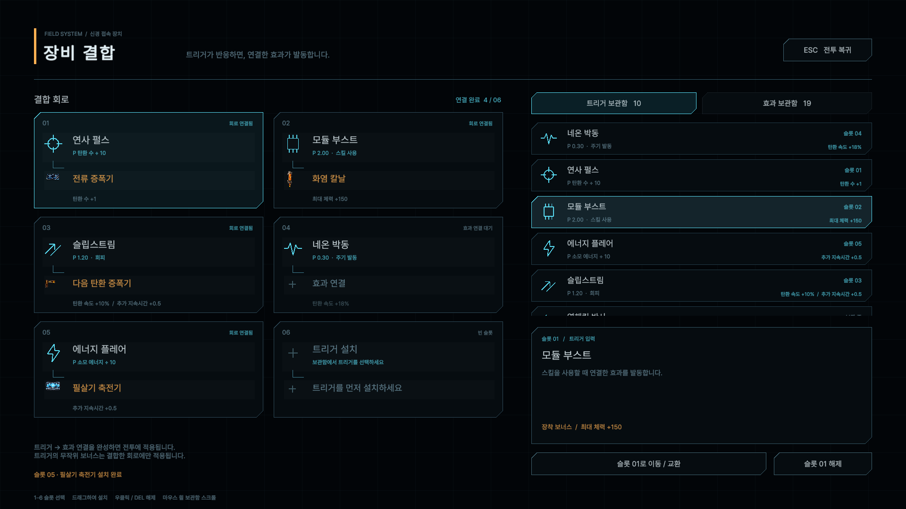
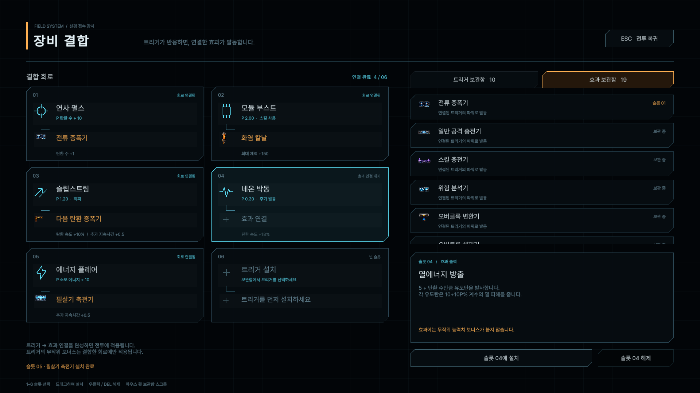

# 6슬롯 장비 결합 화면

2026-10-28 구현. `Assets/Scenes/Play.unity`에서 **ESC**를 누르면 장착 화면이 열린다. `Player.Start()`가 시스템을 자동으로 연결하며, 씬에 별도 Canvas나 EventSystem을 추가할 필요가 없다. 기존 I 키도 같은 화면을 연다.

## 사용법

1. 왼쪽에서 슬롯 01~06의 트리거 영역을 누른다.
2. 오른쪽 트리거 보관함에서 장비를 선택하고 **설치**를 누르거나 슬롯으로 드래그한다.
3. 같은 슬롯의 **효과 연결** 영역을 누르고 효과를 선택해 설치한다.
4. 트리거와 효과가 모두 연결된 회로부터 실제 전투에 적용된다. 트리거가 전달하는 파워를 그대로 효과에 전달한다.
5. **ESC / 전투 복귀**로 닫는다. 메뉴를 연 동안 전투는 일시 정지되고 조작이 잠긴다.

- 슬롯마다 트리거 1개 + 효과 1개, 총 6개 회로다.
- 1~6 숫자키로 슬롯 선택, 더블클릭으로 빠른 설치, 마우스 휠로 보관함 스크롤.
- 우클릭 또는 **슬롯 해제 / DEL**로 현재 장착 부품을 해제한다.
- 효과만 해제하면 트리거는 남는다. 트리거를 해제하면 연결된 효과도 보관함으로 돌아간다.
- 같은 장비 개체를 다른 슬롯으로 옮기면 해당 부품끼리 교환한다. 이동한 원래 슬롯에 트리거가 남지 않으면 그곳의 효과는 보관함으로 돌아간다. 장비는 소실되지 않는다.
- 같은 종류를 여러 개 획득할 수 있으며 서로 다른 장비 개체로 취급한다. 한 개체를 여러 슬롯에 동시에 설치할 수는 없다.
- 전투 후 화면을 다시 열면 완성된 슬롯에 **발동 횟수 · 마지막 파워(P)**가 표시된다. 회로를 교체·해제하면 해당 기록도 초기화된다.

## 화면 구성

선체 단말기 느낌의 어두운 바탕, 절삭된 패널 모서리, 얇은 회로 연결선과 기하학 기호를 사용한다. 청록색은 트리거 입력, 주황색은 효과 출력을 뜻한다. 기존 프로젝트의 효과 스프라이트와 Pretendard 폰트를 재사용했다.

왼쪽은 6개 회로와 파워 조건·트리거 보너스, 오른쪽은 종류별 보관함과 장비 설명·설치 위치를 표시한다. 트리거 기호는 슬롯과 보관함에서 동일하다. 미완성 회로는 효과 연결 대기로 표시하고 보너스를 흐리게 표시한다.

화면은 1920×1080을 기준으로 비율에 맞춰 확장한다. 720p, 1080p, 16:10, 울트라와이드에서도 회로와 버튼이 잘리지 않도록 전체 단말기를 맞춘다. 메뉴를 닫은 직후 클릭이 무기 발사·회피로 넘어가지 않도록 해당 프레임 입력을 억제한다.

## 획득과 보너스

[EquipmentCatalog.asset](../Assets/Resources/EquipmentCatalog.asset)에 기존 콘텐츠의 **트리거 10종·효과 19종**을 연결했다. 지금은 기능을 바로 확인할 수 있도록 초기 지급(`grantStartingKit`)이 켜져 있고, 장착 슬롯은 비어 있는 상태로 시작한다. 실제 획득 중심 진행으로 바꿀 때는 이 옵션을 끈다.

기존 상자 보상(`Player.GivePolyominoReward`)은 새 보관함으로 들어온다. 상자에 지정된 효과 1개와 무작위 트리거 1개를 함께 지급하고 새 화면에서 획득한 효과를 선택한다. 다른 보상 시스템에서는 `EquipmentLoadout.GrantRandom(EquipmentKind.Trigger / Effect)` 또는 `Acquire(definition)`을 호출할 수 있다.

무작위 보너스는 트리거 획득 순간에만 추첨한다. 기본 1종, 35% 확률로 서로 다른 보너스 1종을 더 부여한다. 효과에는 보너스가 없다. 장착·이동·해제로 재추첨하지 않는다. 아래 값은 임시 조정값이다.

| 보너스 | 임시 범위 | 적용 필드 |
|---|---|---|
| 공격력 | +5~15% | `increaseAtk` |
| 공격 속도 | 기본치 기준 +10~25% | `fireSpeed +0.10~0.25` |
| 탄환 속도 | 기본치 기준 +10~25% | `bulletSpeed +0.10~0.25` |
| 쿨다운 감소 | +0.10~0.25 | `skillCooldownDecrease` |
| 최대 체력 | +50 / +100 / +150 | `maxHp` |
| 방어력 | +5~15 | `baseDef` |
| 탄환 수 | +1 | `bulletRate` |
| 추가 지속시간 | +0.5 / +1.0 | `additionalDuration` |
| 스킬 범위 | 기본치 기준 +10~25% | `skillRange +0.10~0.25` |

보너스는 결합이 완성된 회로에서만 적용된다. 교체·해제 시 즉시 재계산한다. 최대 체력이 줄어들면 현재 체력도 새 상한 안으로 제한하며, 최대 체력 증가로 무료 회복을 제공하지 않는다.

보관함과 장착 정보는 현재 실행 중인 플레이어에 귀속된다. 세이브 파일 저장·메타 성장 유지 기능은 이번 구현에 포함하지 않았다.

## 전투 연결과 수명 관리

- [EquipmentLoadout](../Assets/PlayerSystem/Equipment/EquipmentLoadout.cs): 획득 개체, 슬롯 소유권, 교환·해제, 트리거 보너스와 실제 전투 실행체 관리.
- [EquipmentCatalog](../Assets/PlayerSystem/Equipment/EquipmentCatalog.cs): 이름·설명·파워 안내·프리팹·아이콘·초기 지급 설정.
- [EquipmentTerminalView](../Assets/UI/Equipment/EquipmentTerminalView.cs): 화면 구성, 선택·설치·드래그·단축키·일시 정지. UI는 실행 시 생성된다.
- 기존 `Board` 트리거의 파워 계산·쿨다운을 재사용하되, 새 회로에서는 `RuntimeActivation`을 통해 효과로 바로 전달한다. 셀 검사·회전·격자 배치는 사용하지 않는다.
- 기존 효과는 `Polyomino.UseEquipmentMode()`로 격자용 시각 요소와 도형 기반 보너스를 끈다. 효과 오브젝트 자체는 활성 상태를 유지하므로 `RecoveryManager.Update()` 같은 전투 로직은 메뉴를 닫은 상태에서도 작동한다.
- 교체 시 이전 트리거와 그 효과가 등록한 버프·리스너를 해제한다. 이미 발사되었거나 적에게 부여된 별도 투사체·지속 피해는 자체 수명에 따라 종료된다.
- `AssaultStackBuffer`, `PowerInjectionCore`, `NextShotAmplifier`, `NextSkillAmplifier`의 정적 공유 버프를 개체별로 분리했다. 같은 효과 두 개 중 하나를 해제해도 다른 개체의 버프를 제거하지 않는다. 중첩 상한은 각 효과 개체 기준이다.
- 코드만 있던 `PowerInjectionCore`에 새 회로용 최소 프리팹을 추가했다. 나머지 효과의 투사체·화상·전기장 등은 기존 프리팹을 재사용한다.
- 기존 플레이어의 보드 인벤토리는 새 시스템 초기화 시 숨기고 이벤트 등록을 해제한다. 구형 보드 코드는 과거 씬·기록을 위해 남겨뒀다. 메모리 보드용 에셋형 효과 5종은 이 카탈로그에 포함하지 않았다.

## 검증

원본과 같은 **Unity 6000.0.60f1**의 격리 프로젝트에서 검증했다. 원본 프로젝트의 Unity 버전·패키지 설정은 변경하지 않았다.

- 런타임 C# 컴파일 통과.
- 콘텐츠·모델·화면·실제 DropHandler 검사 35개 통과: 29개 프리팹 참조, 6슬롯, 효과 선행 설치 거부, 실제 스킬 이벤트 → 파워 2 → 공격력 증가, 교환·해제·보너스 유지, 메뉴 정지·복귀, 드래그 설치·잔상 제거, 닫는 프레임 입력 차단, 최대 체력 보너스와 회복 상한 반영.
- 실제 `Player.Start()`로 시작한 플레이 모드 검사 15개 통과: 자동 연결, 개체별 중복 효과·독립 해제, 보이지 않는 회복 효과의 실제 Update, 비활성화·재활성화 정리, 기존 상자 보상 경로, 플레이어 삭제 후 시간 복원.
- [1080p 트리거 화면](Previews/EquipmentTerminal-Triggers.png), [효과 화면](Previews/EquipmentTerminal-Effects.png), [720p](Previews/EquipmentTerminal-720p.png), [16:10](Previews/EquipmentTerminal-16x10.png), [울트라와이드](Previews/EquipmentTerminal-Ultrawide.png)를 Unity URP에서 직접 렌더링했다.

## 전투 이벤트 연결 수정 (2026-10-28)

저스트 회피 알림을 플레이어 갱신 끝까지 보류하던 순서 때문에, 같은 프레임의 후속 공격이 먼저 명중하면 화염 칼날이 아직 등록되지 않았다. 수정 전 실패하는 조건을 재현한 뒤, 다음 행동·피해 이벤트와 장비 화면 열기 전에 보류된 회피 알림을 먼저 전달하도록 수정했다. 알림은 전달 전에 비워 동기 재진입으로 중복 발동하지 않게 했다.

- 회피 판정을 공격자 명중 알림보다 먼저 처리한다. 빗나간 공격으로 공격자의 명중 트리거·에너지가 발생하지 않으며, 회피 불가 태그는 회피하지 않는다.
- `DamageGiveEvent`는 피해 적용 전 보정 단계로 유지한다. 실제 HP 감소 후 `DamageDealtEvent`를 보내며, 화염 칼날은 이 확정 명중을 받아 일반 공격·스킬·필살기 화상을 부여한다. 피해 0, 사망 대상, 화상 자체의 틱으로는 새 화상을 만들지 않는다.
- 행동형 트리거는 이벤트의 행동 주체가 장착 소유자인지 확인한다. 저스트 회피와 과충전도 소유자·원인 공격을 확인한다.
- 화상은 정확히 2초 누적 시 피해를 주며 긴 갱신에서도 누적 틱을 처리한다. 화염 파티클을 대상 스프라이트 위에 그린다.
- 재부팅의 회복량은 장비 보너스를 포함한 캐시 최대 체력의 10%, 최소 1 HP를 사용한다.

동일 버전의 격리 Unity에서 **10종 트리거 및 화염 칼날 계약 검사 35개**를 통과했다. 소유자 필터, 파워·축적·쿨다운, 회피/회피 불가, 세 공격 분류, 화상 쿨다운·2초 틱·연쇄 방지·장착 해제를 확인했다. 별도 플레이 모드에서는 실제 회피 판정 → 같은 프레임 샷건 명중 → 화상 부여와, 실제 탄환 충돌 이후 화상의 HP 감소까지 확인했다. 전체 190개 조합을 개별 전투 실행한 결과는 아니다.

수동 확인: `Play` 씬에서 ESC → 저스트 회피 + 화염 칼날 설치 → 적의 공격을 저스트 회피 → 샷건으로 생존한 적 명중. 적에게 화염이 붙고 게임 시간 2초마다 체력이 줄어야 한다. ESC로 다시 열어 해당 슬롯의 발동 횟수와 P를 확인할 수 있다. 예를 들어 회피한 원본 피해가 100이면 P는 2.5다.

전체 `Play` 씬의 전투·기존 UI와의 화면 조화, 게임패드 조작과 저장 기능은 별도 검증·작업 범위다.
