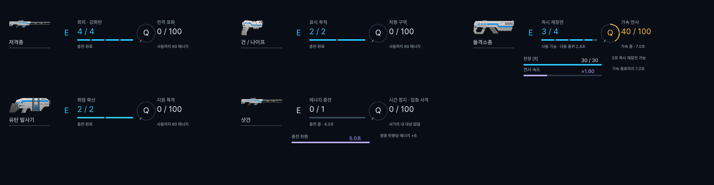

# 무기 스킬·필살기 HUD

2026-10-23 구현. `Assets/Scenes/Play.unity`를 실행하면 플레이어에게 등록된 무기가 화면 하단 중앙에 HUD를 생성한다. 현재 `SamplePlayer`의 무기 참조는 샷건이다. 별도로 Canvas를 씬에 배치할 필요가 없다. 다른 무기는 `Player.weapon`에 해당 프리팹을 지정한다.

위 이미지는 실제 무기 상태를 읽어 Unity URP에서 렌더링한 비교 화면이다. 플레이 중에는 장착한 무기 하나의 패널만 표시된다.

## 표시 내용

- **E 스킬:** 현재/최대 보유 횟수, 보유 횟수만큼 채워진 분할 게이지, 다음 1회 충전 진행도와 남은 초. 1회 이상 보유하면 다음 충전 중에도 사용 가능하다.
- **Q 필살기:** 현재 에너지/에너지 상한, 원형 게이지의 사용 비용 위치에 흰 눈금, 사용까지 필요한 에너지. 기본 비용 60과 상한 100을 구분한다.
- **상태 문구:** 준비·다음 충전 시간·시전 단계·대상 없음 등 필요한 상태만 한국어로 표시한다. 탄창·지속 효과는 기본 HUD 아래에 작은 보조 행으로 나타난다.
- 무기 실루엣·이름, 스킬 분할 막대, Q 둘레의 필살기 원형 게이지. 충전은 청록색, 필살기는 금색, 지속 효과는 보라색으로 구분한다. 카드 배경·테두리·역할 설명·영문 배지를 제거했다.

| 무기 | 전용 표시 |
|---|---|
| 저격총 | 회피·강화탄 4회, 강화탄 장전 상태, 조준 중 사용 제한, 정밀 조준 시간·준비 여부, 필살기 중 마우스 버튼을 놓아 발사하는 안내 |
| 건/나이프 | 표식 투척 2회, 처형 구역 에너지 |
| 돌격소총 | 즉시 재장전 4회, 탄창 잔량, R 재장전 진행·남은 시간, 필살기 활성 시간·현재 연사 배율 |
| 유탄 발사기 | 화염 확산 2회, 지원 폭격 에너지 |
| 샷건 | 에너지 충전 스킬 1회, 충전 탄환 효과 남은 시간·탄환당 에너지, 필살기 시전 상태, 사거리 내 대상 부재 |

충전 시간은 실제 게임 쿨다운으로 표시한다. 충전 시작 시의 쿨다운 감소 스탯으로 해당 회차의 시간을 확정하므로 도중에 스탯이 바뀌어도 진행도 분모가 튀지 않는다. 다음 회차부터 변경된 스탯을 반영한다. 저격총·건/나이프도 이 기준에 맞췄다.

## 구조와 확장

- [Weapon](../Assets/PlayerSystem/Weapons/Weapon.cs)은 `hudPrefab`, `hudIcon`을 무기별로 갖는다. 플레이어 등록 시 생성하고 비활성화·장착 해제 시 숨기며, 재활성화 시 재사용하고 무기 삭제 시 함께 정리한다. HUD는 회전·좌우 반전되는 무기의 자식이 아니다.
- 무기는 `WriteHud(WeaponHudState)`로 필요한 표시 행을 제공한다. [WeaponHudState](../Assets/PlayerSystem/Weapons/Hud/WeaponHudState.cs)는 제목·이미지·게이지·횟수·상태를 전달하는 모델이며 독립된 `WeaponHudModel` 어셈블리다.
- [WeaponHudView](../Assets/UI/WeaponHudView.cs)는 전달받은 행을 표시한다. 특정 무기 클래스를 검사하지 않는다. 새로운 무기는 행을 추가하거나 `hudPrefab`을 별도 `WeaponHudView` 파생 프리팹으로 교체하고 `Render`를 재정의할 수 있다.
- 현재 5종은 [WeaponHud.prefab](../Assets/UI/WeaponHud.prefab)을 공유한다. Inspector에서 폰트, 게이지 스프라이트, HUD 폭(600~760), 화면 위치 오프셋, 스킬·필살기 색을 조절한다. 내부 UI 계층은 실행 시 생성한다.
- `CanvasScaler` 기준은 1920×1080, 화면 Safe Area를 반영한다. HUD의 이미지·텍스트는 레이캐스트를 받지 않고 `CanvasGroup`도 입력을 가로채지 않는다.
- 기존 저격총의 0배율 Canvas와 직접 UI 참조, 다른 무기의 시험용 `OnGUI` 문자열은 제거했다.

## 이미지·폰트

무기 프리팹의 실제 본체 스프라이트를 사용한다. 신규 무기는 `weaponSprite`, 기존 저격총·건/나이프는 `hudIcon`에서 읽는다.

한글은 프로젝트에 있던 `PretendardVariable.ttf`로 만든 별도 [WeaponHudFont](../Assets/UI/WeaponHudFont.asset)를 사용한다. 48pt SDF, 1024×1024 동적 아틀라스, 다중 아틀라스 지원. 기존 공유 폰트 에셋은 수정하지 않았다.

## 검증

원본 프로젝트 버전은 Unity 6000.0.60f1이다. 설치된 Unity 6000.3.24f1의 격리 프로젝트에서 변경된 런타임 코드를 컴파일하고 원본 에셋을 복사해 검증했다. 원본 프로젝트를 에디터에서 업그레이드하지 않았다.

- NUnit EditMode: 기존 무기 규칙 9개 + 새 발사·분배·에너지 규칙 14개 + HUD 상태 6개, 총 29개 통과. 에너지 상한·비용 구분, 부분 충전 중 사용 가능, 사용 제한 우선, 활성 상태, 상태 초기화를 검사한다.
- 프리팹·상태·렌더링: 5종 HUD 참조·이미지·초기 충전량, 돌격소총 충전·재장전·필살기 활성, 샷건 충전 효과·대상 제한, 입력 비차단 등 41개 검사 통과.
- 플레이 모드: 5종 자동 생성·올바른 소유자 연결·Overlay·비활성화·재활성화·재등록·장착 해제·복구와 삭제 후 정리, 41개 검사 통과. 테스트 에디터의 SearchDatabase 시작 인덱싱에서 별도 예외가 기록됐으며 HUD 런타임에서는 예외가 없었다.
- [720p](Previews/WeaponHud-720p.png), [1080p](Previews/WeaponHud-1080p.png)와 5종 비교 화면을 실제 렌더링해 한글·숫자·게이지를 확인했다. 비교 화면은 돌격소총 필살기·샷건 충전 효과가 활성화된 예시다.

원본 전체 Play 씬에서의 전투 플레이 검증은 별도로 필요하다. 게이지와 무기 상태 검증은 위 격리 실행 범위다.
